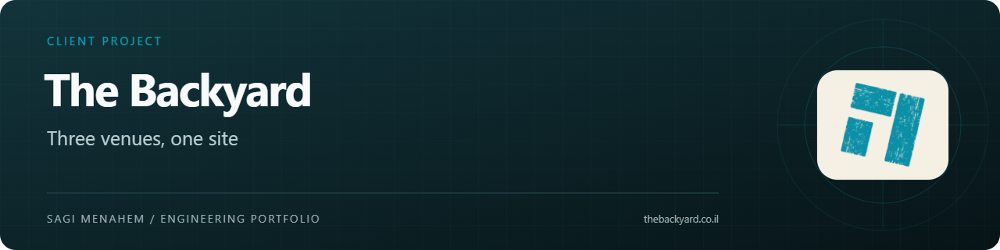
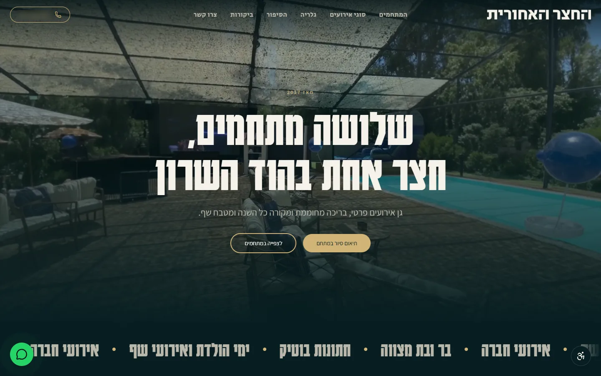
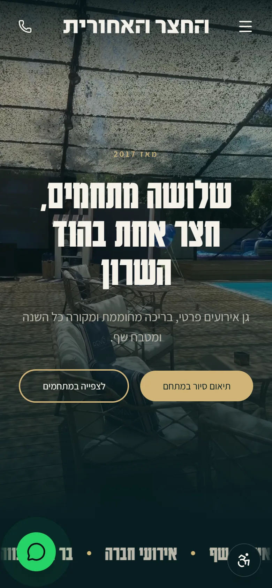
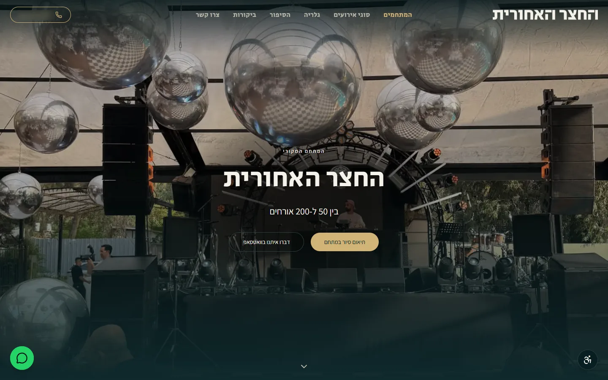

# The Backyard

A website and content platform for an events venue in Hod HaSharon with three spaces: The Backyard, HaHursha and The Loft.

**Type:** Client platform · **My role:** Sole engineer, end to end · **Source:** Private; this repository is a public case study.

[Visit the live site](https://www.thebackyard.co.il)

   

## Preview

  
  
   
  

## Problem and solution

The venue ran three WordPress sites, one per space, built at different times. They disagreed on phone numbers and addresses, carried duplicate and outdated pages, and could not be updated without outside help. Enquiries also had to reach the CRM the sales team already works in, not another inbox.

This platform replaces all three with one Hebrew, RTL-first site and a CMS the venue team runs themselves. Every enquiry is stored, announced on WhatsApp and delivered to the CRM, and every legacy URL was mapped so the move did not discard the search visibility the old sites had earned.

## Product highlights

- Venue and event-type pages with hero video, galleries, reviews and a campaign landing page.
- An admin organised by areas of the site rather than database tables, with drag-to-reorder lists and editable legal pages.
- A media library built for phones: resumable uploads, HEIC conversion and in-browser compression and cropping.
- Enquiry forms and WhatsApp buttons that record a lead first, then alert the team and deliver it to the CRM.
- Consent-gated Google measurement per venue, alongside first-party analytics that store no IP address, cookie or user agent.

## Engineering decisions

- **Never lose a lead, never send it twice.** Submissions are idempotent; the CRM delivery job is written in the same transaction as the lead, claimed by a scheduled worker with `SKIP LOCKED`, and an HTTP 200 alone is not treated as proof of delivery.
- **Migrate URLs in the proxy, then prove it on the wire.** 88 legacy URLs from three domains map to a single 301 or a 410 for junk pages, with Hebrew paths decoded explicitly. An audit script checked 162 redirects and 14 destination pages against production after the cutover, with zero findings.
- **Keep the site renderable without the database.** Content defaults live in code, so every page renders even before the CMS holds data, and the admin edits override them.
- **Make security rules executable.** Each project rule has its own test, and every table ships with row-level security in the same migration; 1,288 tests run before a release.
- **Review real content for privacy.** Photos of identifiable people are blocked from share previews by an automated check.

## Stack

Next.js App Router, React, TypeScript, Tailwind CSS, Supabase Postgres and Auth, next-intl, Zod, Radix UI, Vercel (with scheduled jobs), Sentry, Vitest and Playwright.

---

Content © The Backyard · Code by [Sagi Menahem](https://sagimenahem.tech) · [AfterTech](https://www.after-tech.co.il/)
